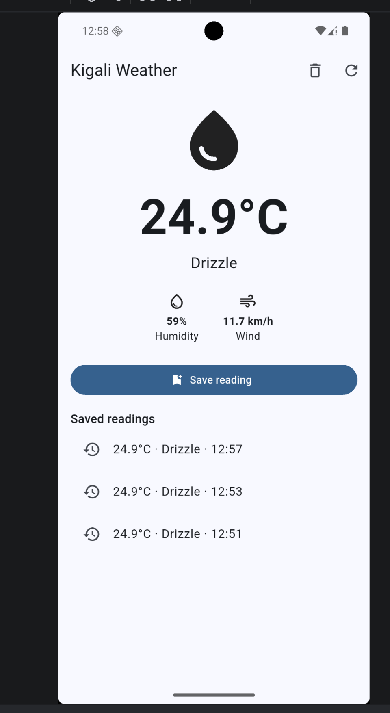
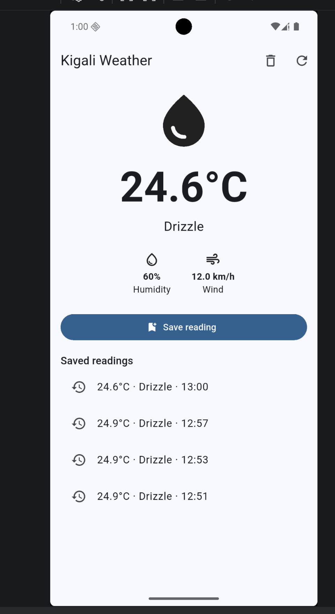
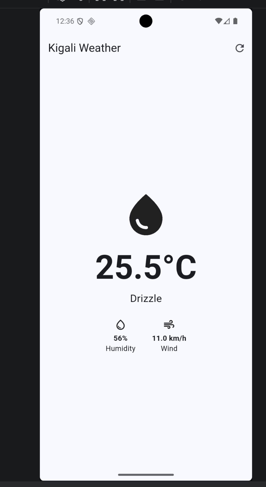
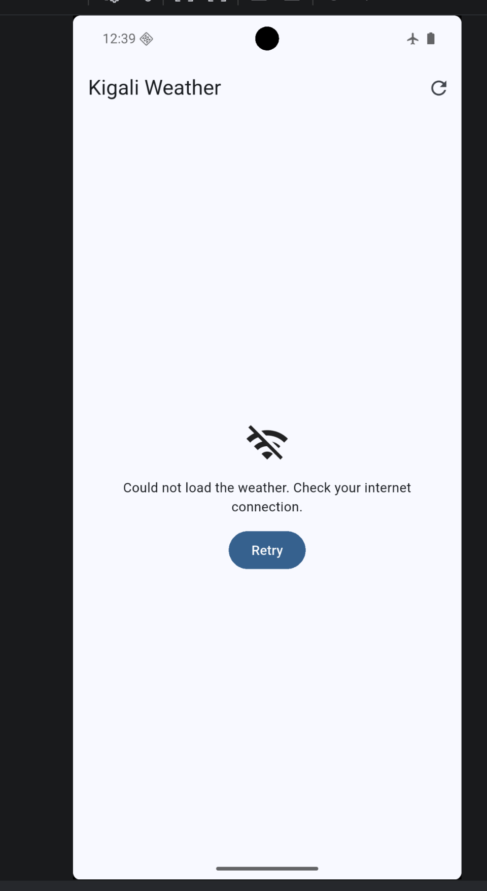

# Kigali Weather

A Flutter app that shows the current weather in Kigali. My data is now saved on the phone with shared_preferences, so nothing is lost when the app closes, and it shows live temperature, humidity, wind and conditions from the Open-Meteo API.

## Features

- Live weather for Kigali (temperature, humidity, wind speed, conditions)
- "Save reading" button that stores the current reading with the time
- Saved readings stay on the phone after the app is closed
- Trash button to clear saved readings
- Error message and Retry button when there is no internet

## Screenshots

## How it works

- `lib/main.dart`: the screen, the Save reading button and the saved list
- `lib/weather.dart`: the `Weather` class and the function that calls the API
- Saved readings are stored as a `List<String>` with `shared_preferences`
- Weather data comes from [Open-Meteo](https://open-meteo.com/) (no API key needed)

## Run it

    flutter pub get
    flutter run